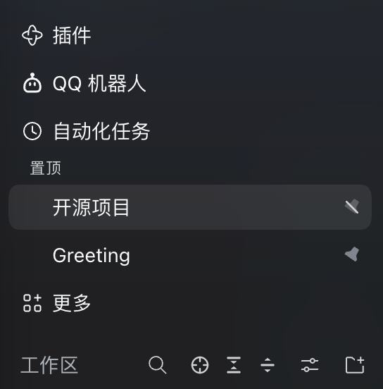
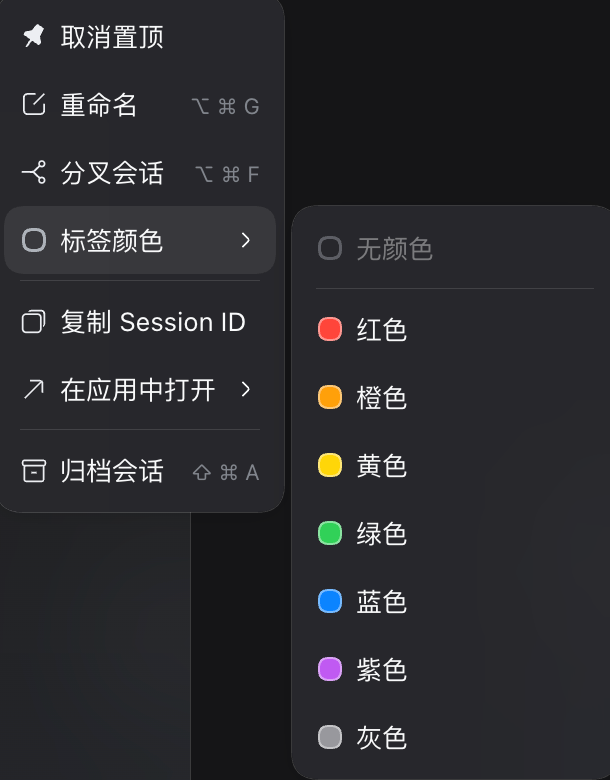
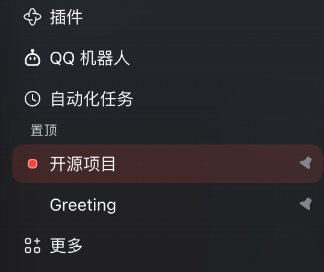
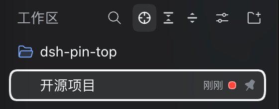
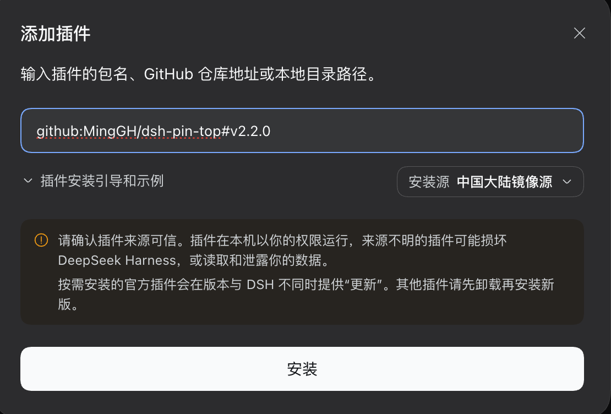

# dsh-pin-top

A DeepSeek Harness (DSH) plugin: gathers the harness's own pinned sessions into a dedicated sidebar section, and adds macOS-style colour labels plus workspace navigation buttons.

English | [中文](README.md)



1. **Pinned sessions gathered** — reads DSH's own `pinnedSessionIds` and shows each pinned session as a row in its own sidebar section, opened in a single click. Pinning and unpinning still go through the harness's menu item and hover pin; this plugin keeps no second copy of that state.
2. **Colour labels** — right-click any session to pick a colour; it pins the session through the harness's own `pinSession`, and the row tint and dot follow.
3. **Three header buttons** — locate the current session, collapse all, expand all.

The three parts are independent: a missing service degrades only its own feature and never keeps the host from booting.

## Colour labels

Right-click any session row → **Label colour ▸**:



After picking a colour the row leading cell becomes a dot and the row is tinted in that colour:



- Seven macOS system colours, with dark variants applied automatically; the current colour is marked ✓.
- Picking a colour also pins the session; **No colour** clears the label without unpinning, and the in-row unpin action unpins without dropping the label.
- An idle pinned row shows its colour dot; while running, waiting, or unread it shows the host's own status indicator instead. Shipped session rows get a matching dot to the left of their timestamp.
- Colours live in `~/.dsh/pin-top/labels.json`, read and written by the Host half over `GET` / `POST /pin-top/labels` behind the host's connection check.

## Locate, collapse, and expand



- **◎ Locate** — scrolls the current session into view; when it is hidden by a collapsed group it opens only that session's own group chain. It neither selects nor opens the session.
- **⤓⤒ Collapse all** / **⤒⤓ Expand all** — these click the host's own group rows, so expansion state and the host's persisted view stay exactly in sync.


(Left: locate. Middle: collapse all. Right: expand all. Rendered from the coordinates in the code; the real glyphs follow the theme foreground.)

## Install

```sh
# Web
dsh plugin --profile web add github:MingGH/dsh-pin-top#v2.2.0

# Desktop (macOS; on Windows use %LOCALAPPDATA%\Programs\DeepSeek Harness\resources\runtime\cli\bin\dsh.cmd)
"/Applications/DeepSeek Harness.app/Contents/Resources/runtime/cli/bin/dsh" \
  plugin --profile desktop add github:MingGH/dsh-pin-top#v2.2.0
```

Or open **Plugins** → **Add plugin** and paste `github:MingGH/dsh-pin-top#v2.2.0`:



After a restart, confirm the `dsh-pin-top` switch is on in **Plugins**. `add` only installs the package; the switch is what lists it under `dsh.profile.bundles`.

To update, `remove` the old version and `add` the new one; to uninstall, `remove dsh-pin-top`.
For local development use `add file:<path to this repo>`, or `plugin_manager` `install_bundle` with the repository root as its target.

## Development

```sh
node _test/smoke.mjs     # 256 assertions
node --check client.js
node --check index.js
```

```
package.json          # bundle manifest (dsh.bundle.patch + dsh.client)
cordis.patch.yml      # inserts one Host row
index.js              # Host half: label store + /pin-top/labels routes
client.js             # Client half: pinned section, colour menu, header buttons, styles, zh/en dictionaries
locale/{zh,en}.json   # display metadata
icon.svg
docs/                 # README screenshots
_test/smoke.mjs       # offline smoke test
```

Appearance is driven by `TUNING` at the top of `client.js` (row height, spacing, tint strength, collapse limit, menu order); saving the file hot-reloads it.

## Known limits

- One colour per session, stored locally, not synced across machines.
- The pinned section holds at most `maxVisible + 2` rows (6 by default); the rest collapse into "N more pinned…".
- In the collapsed rail the section label and control rows are hidden, leaving only icons per row.
- Dictionaries cover zh and en only.

## Changelog

| Version | Change |
| --- | --- |
| 1.0 | Pinned section in the sidebar, opened in a single click |
| 1.1 | The row's pin matches the host pin badge, with a slash on hover |
| 2.0 | macOS-style colour labels; picking a colour pins the session |
| 2.1 | "No colour" moved first, whole-row right-click, Shift+F10 |
| 2.2 | Three header buttons: locate / collapse all / expand all |

## License

MIT
