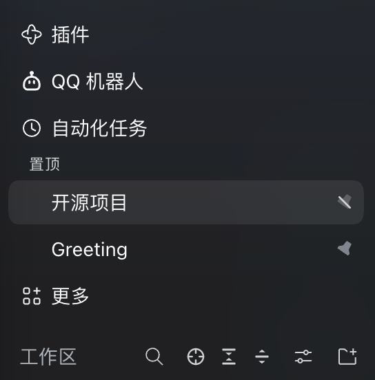
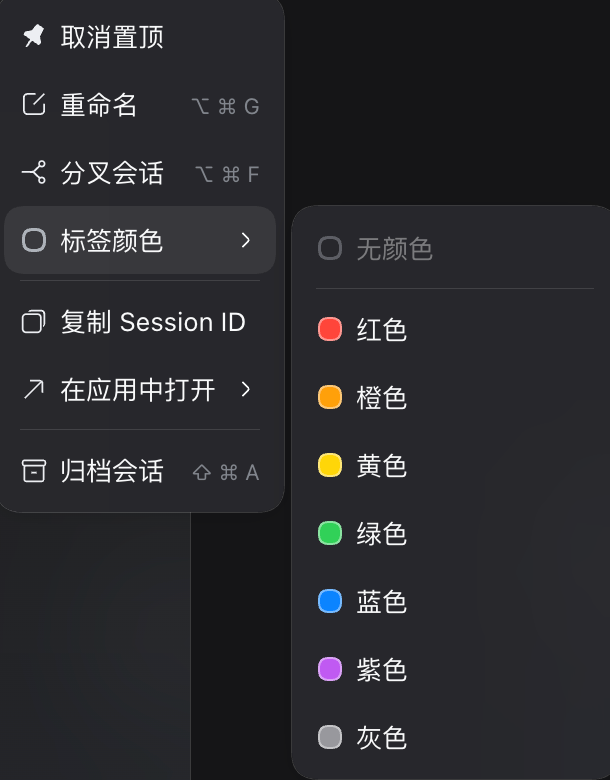
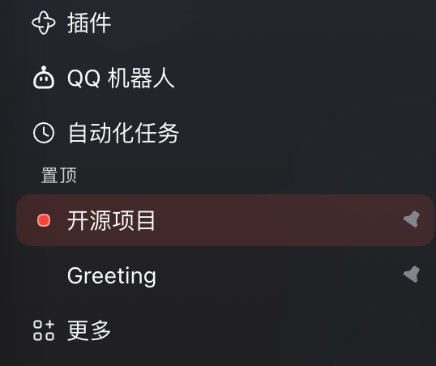
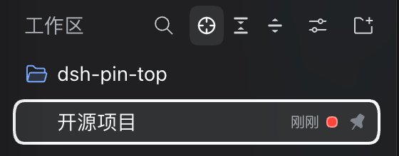
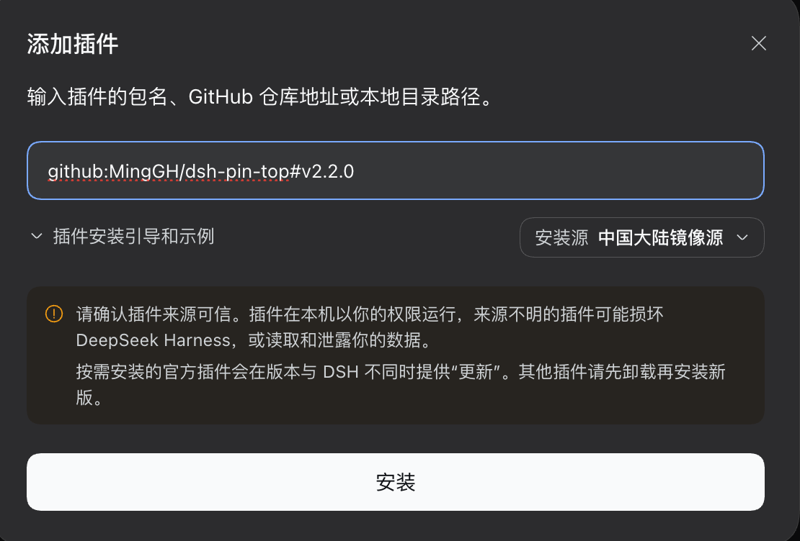

# dsh-pin-top

[English](README.en.md) | 中文

DSH（DeepSeek Harness）插件：把官方置顶的会话汇总成侧边栏独立分区，再加 macOS 式颜色标签与工作区导航按钮。



1. **置顶会话汇总**：读取官方 `pinnedSessionIds`，把置顶会话收进侧边栏顶部独立分区，每会话一行，点一下直接打开。置顶与取消置顶仍走官方的右键菜单项和悬停图钉，本插件不另存一份置顶状态。
2. **颜色标签**：右键任意会话选色，自动置顶（调用官方 `pinSession`），行底色与圆点跟着变色。
3. **标题栏三按钮**：定位当前会话、全部收起、全部展开。

三块互不依赖：服务缺失时只降级对应功能，不会让宿主启动失败。

## 颜色标签

右键任意会话行 →「标签颜色 ▸」：



选色后行首变圆点、行底色同色淡染：



- 七种 macOS 系统色，深色主题自动换 dark 变体；当前颜色前带 ✓。
- 选色即置顶；「无颜色」只清色不动置顶；行尾「取消置顶」只取消置顶、不删颜色。
- 置顶行行首在空闲时显示颜色圆点，忙碌 / 待处理 / 未读完成时显示宿主同款状态指示；内置会话行时间左侧也有同色圆点。
- 颜色存 `~/.dsh/pin-top/labels.json`，由 Host 半边经 `GET/POST /pin-top/labels` 读写，走宿主连接鉴权。

## 定位、收起与展开



- **◎ 定位**：滚动到当前会话；被折叠挡住时只展开它自己的分组链，不选中、不打开。
- **⤓⤒ 全部收起** / **⤒⤓ 全部展开**：直接点击宿主自己的分组行，展开状态与宿主持久化完全一致。


（左：定位；中：全部收起；右：全部展开。按代码坐标渲染，实际跟随主题前景色。）

## 安装

```sh
# Web 端
dsh plugin --profile web add github:MingGH/dsh-pin-top#v2.2.0

# 桌面端（macOS；Windows 换成 $env:LOCALAPPDATA\...\resources\runtime\cli\bin\dsh.cmd）
"/Applications/DeepSeek Harness.app/Contents/Resources/runtime/cli/bin/dsh" \
  plugin --profile desktop add github:MingGH/dsh-pin-top#v2.2.0
```

或在「插件」页 →「添加插件」粘贴 `github:MingGH/dsh-pin-top#v2.2.0`：



重启后到「插件」页确认 `dsh-pin-top` 开关已开（`add` 只装包，开关决定随组合加载）。

更新 = `remove` 旧版再 `add` 新版本号；卸载 = `remove dsh-pin-top`。
本地调试用 `add file:<仓库路径>`，或用 `plugin_manager` `install_bundle`（target = 仓库根目录）。

## 开发

```sh
node _test/smoke.mjs     # 256 项断言
node --check client.js
node --check index.js
```

```
package.json          # bundle 清单（dsh.bundle.patch + dsh.client）
cordis.patch.yml      # 插入一行 Host 行
index.js              # Host 半边：颜色存储 + /pin-top/labels 路由
client.js             # Client 半边：置顶区、颜色菜单、标题栏按钮、样式、zh/en 词典
locale/{zh,en}.json   # 展示元数据
icon.svg
docs/                 # README 截图
_test/smoke.mjs       # 离线冒烟测试
```

外观参数集中在 `client.js` 顶部的 `TUNING`（行高、间距、底色浓度、折叠上限、菜单位置等），改完存盘即热更新。

## 已知边界

- 每个会话一种颜色，存本地、不跨机同步。
- 置顶区最多 `maxVisible + 2` 行（默认 6），超出折叠为「还有 N 个置顶…」。
- 窄栏模式下小标题与控制行隐藏，置顶行只剩图标。
- 词典只有 zh / en。

## 变更记录

| 版本 | 变化 |
| --- | --- |
| 1.0 | 侧边栏「置顶」分区，一次点击打开 |
| 1.1 | 行尾图钉与宿主置顶徽标同形，悬停出现斜线 |
| 2.0 | macOS 式颜色标签，选色即置顶 |
| 2.1 | 「无颜色」提到首位、整行可右键、Shift+F10 |
| 2.2 | 标题栏三按钮：定位 / 全部收起 / 全部展开 |

## License

MIT
